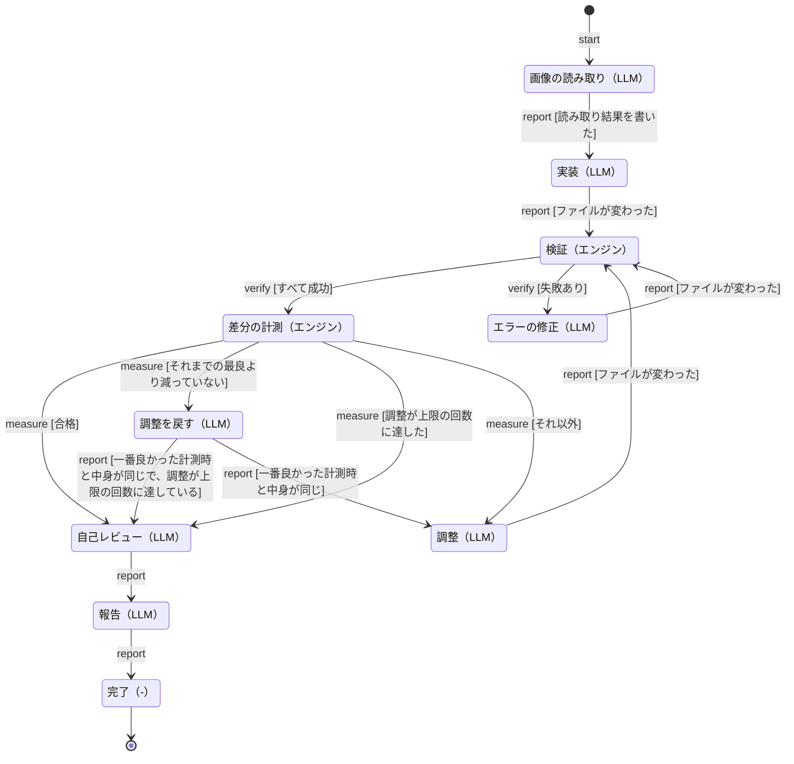

# design-flow の状態遷移

このファイルは `pnpm docs:flow` で `scripts/lib/flow/machine.mjs` の遷移表から生成している。手で書き換えず、遷移表を直してから生成し直す。

## 手順

| 手順 | 内容 | 担当 | 終えるときのコマンド |
| --- | --- | --- | --- |
| `read` | 画像の読み取り | LLM | `design-flow report read` |
| `implement` | 実装 | LLM | `design-flow report implement` |
| `verify` | 検証 | エンジン | `design-flow verify` |
| `fix` | エラーの修正 | LLM | `design-flow report fix` |
| `measure` | 差分の計測 | エンジン | `design-flow measure` |
| `adjust` | 調整 | LLM | `design-flow report adjust` |
| `revert` | 調整を戻す | LLM | `design-flow report revert` |
| `review` | 自己レビュー | LLM | `design-flow report review` |
| `report` | 報告 | LLM | `design-flow report report` |
| `done` | 完了 | - | - |

## 遷移

同じ手順・同じ入力の行は、上の行の条件から順に見て、最初に当てはまった行の行き先へ進む。`report` で条件に当てはまらないときは、報告を拒否して手順は進まない。

| 手順 | 入力 | 条件 | 行き先 |
| --- | --- | --- | --- |
| `read` | `report` | 読み取り結果を書いた | `implement` |
| `implement` | `report` | ファイルが変わった | `verify` |
| `fix` | `report` | ファイルが変わった | `verify` |
| `adjust` | `report` | ファイルが変わった | `verify` |
| `revert` | `report` | 一番良かった計測時と中身が同じで、調整が上限の回数に達している | `review` |
| `revert` | `report` | 一番良かった計測時と中身が同じ | `adjust` |
| `review` | `report` | - | `report` |
| `report` | `report` | - | `done` |
| `verify` | `verify` | すべて成功 | `measure` |
| `verify` | `verify` | 失敗あり | `fix` |
| `measure` | `measure` | 合格 | `review` |
| `measure` | `measure` | それまでの最良より減っていない | `revert` |
| `measure` | `measure` | 調整が上限の回数に達した | `review` |
| `measure` | `measure` | それ以外 | `adjust` |
